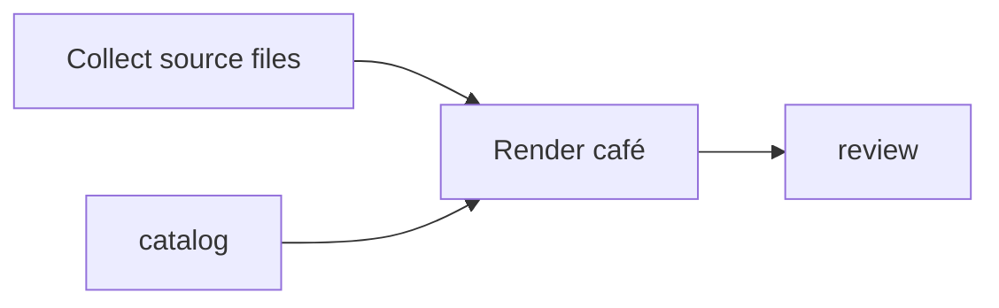

# Import a Mermaid dependency diagram

Bring a small Mermaid flowchart from a design note into an editable declared
plan. The diagram supplies node identities and prerequisite arrows. A separate
binding file selects original source operations and local input files. This
removes retyping dependencies without asking Flow to interpret a goal or label.

```text
moonflow plan preview-mermaid WORKSPACE SOURCE_GRAPH_REF BINDINGS_REF DIAGRAM_REF DRAFT_ID RECORDED_AT
moonflow plan from-mermaid WORKSPACE SOURCE_GRAPH_REF BINDINGS_REF DIAGRAM_REF DRAFT_ID RECORDED_AT
moonflow plan inspect WORKSPACE DRAFT_ID
moonflow plan export WORKSPACE DRAFT_ID
moonflow plan prepare WORKSPACE DRAFT_ID CATALOG_REF RECORDED_AT
```

Start with the [complete portable example](../examples/mermaid-plan/README.md).
Preview is read-only and validates all selected local inputs. Save performs the
same checks and creates one ordinary v2 plan draft plus an exact source receipt.
The receipt contains original source graph, binding JSON and diagram text,
their raw SHA-256 digests, references and import time. It is provenance for the
initial import; it does not claim later draft edits still match the diagram.
An interrupted save after receipt persistence can be retried with exact inputs.
An existing edited draft or different source receipt is never overwritten.

## Supported diagram subset



- First nonempty/noncomment line: `graph` or `flowchart`, one or more spaces,
  then `TD`, `TB`, `BT`, `LR` or `RL`. Orientation is presentation only.
- One node or `-->` chain per line, including inline rectangular node labels.
  `A --> B` always means A must precede B, including right-to-left diagrams.
- Bare identifiers use 1..128 ASCII letters, digits, `_` and `-`; `end` is
  reserved. A node ID must differ from all original source work item IDs.
- Labels may be `A[Text]` or `A["Text"]`. Labels are retained for inspection;
  the last explicit label wins, following Mermaid. Quotes, brackets, backticks,
  backslashes, semicolons and angle brackets inside labels are not supported.
- Blank lines, LF/CRLF, terminal newline and full-line `%%` comments work.
  UTF-8 BOM and Mermaid initialization directives are refused.
- Nodes keep first-appearance order; dependencies keep arrow order. Isolated
  nodes, forward references, branches, joins and chains are supported.

This is a deliberately small subset of [Mermaid's official flowchart
syntax](https://mermaid.js.org/syntax/flowchart.html). Subgraphs, classes/styles,
click handlers, multiple statements separated by semicolons, Markdown fences,
edge labels, other shapes, other arrow forms, inline comments and expressions
are rejected with line context. They are not silently flattened. Only whole-line
comments and orientation have no work semantics. A cycle, self edge or repeated
dependency refuses the entire import.

## Explicit bindings

```json
{
  "contract_id": "moonflow.mermaid-plan-bindings.v1",
  "nodes": {
    "collect": {
      "template_work_item_id": "original-operation",
      "input_artifacts": ["requests/collect.json"],
      "acceptance_criteria": ["Review this exact output"],
      "timeout_ms": 60000
    }
  }
}
```

Supply one entry for every diagram node and no others. Template and nonempty
input list are required. Criteria and whole-number timeout are optional and
otherwise copied exactly from that node's template. Explicit null is not a
default. Unknown fields, including operation, authority and dependencies, fail.
Raw JSON is checked for duplicate decoded object keys at every level in both
the source graph and bindings, including escaped spellings of the same key.
Timeout numbers are checked as exact decimal coefficients/exponents before
integer conversion. `1.0`, `1000e-3` and `8.64e7` are valid; a fractional token
such as `1.000000000000000001` is refused even if floating point rounds it to 1.
The same check applies to inherited source timeouts. After validation, source
numbers use the normal draft representation; exact original texts remain in
the source receipt.
Dependencies come exclusively from the diagram; original template dependencies
are not copied. Product, operation version, schemas, owner, requested authority
and claim ceiling come exclusively from the chosen source template. New
declaration identities prevent inheriting old accepted checkpoints by accident.

Library callers importing text should use `declared_plan_from_mermaid_text_v1`.
The pre-decoded `Json` entrypoint remains available for programmatically built
values. It cannot recover duplicate keys or numeric spellings already discarded
by the caller's parser; preserved numeric representations are checked exactly.

Diagram and binding inputs never imply dynamic output-to-input wiring. Payload
files must already exist within the CLI workspace. Existing plan editing,
preparation and conformant graph import remain separate steps. Preparing an
edited plan rechecks current catalog health and inputs. No dispatch is performed.

## Limits and evidence

At most 1 MiB of UTF-8 diagram text, 256 nodes and 4,096 arrows; the CLI accepts
at most 2 MiB across the source graph, bindings and diagram. JSON nesting is
limited to 64. All graph validity and path containment rules still apply.
The original source files are read-only. A saved receipt contains their content,
so review it before sharing if the inputs contain private information.

Focused native/JS tests cover import semantics, source-contract preservation,
draft editing/preparation, presentation-only changes, deterministic identity,
malformed/unsupported input and limits. A compiled-CLI fixture exercises preview,
save/repeat, source receipt verification, edit and prepare, plus refusal paths.
This does not qualify Mermaid rendering, a live host UI, provider/adapter
execution, restart recovery, production installation or full product release.
